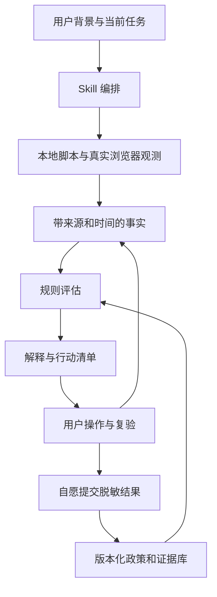

# 目标服务 注册风控助手项目方案

方案版本：v0.2，保留 2026 年 10 月 17 日的完整研究规划。2026 年 10 月 18 日已开始 alpha 实现，项目定名为知彼 Zhibi（zhibi）。本文后续章节的功能清单是规划，当前实现与验收以 [路线图](roadmap.md) 和 [架构](architecture.md) 为准。

## 2026-10-19 范围修订：覆盖完整，使用可选

本节是最新产品范围约定，优先于后文早期“第一版取舍”的排期表述。项目应覆盖已识别的 目标服务 检测、网络/IP 情报、浏览器/系统诊断、环境维护和协助交付能力。用户可以不启用，项目不能因为默认流程不需要就把能力删掉。

默认流程继续简单、免 Key；深入检测、额外来源、上游模型对照、环境配置和恢复通过可选模块提供。采集特征与解释风控意义分开，证据不足限制结论，不自动取消检测能力。

每项上游功能以[能力覆盖清单](capability-coverage.md)登记实际状态、实现入口/缺口和依赖。代码适配、独立实现和外部工具适配均可；只提供链接或教程不算已经接入。当前 v0.2.0a3 尚未完整覆盖。优先级只决定开发顺序，不缩小最终范围。

项目面向准备注册和开始使用 目标服务 的用户，从风控从业者视角研究平台目标、判断对象、关联关系与事件时间，把公开证据和用户可观测事实转化为注册准备及异常处理建议。同时公开审查检测网站与开源方案中的特征解释、风险评分和效果承诺，减少缺乏证据的结论对用户决策的误导。第一版交付 Skill、可独立执行的检测核心、浏览器探针、证据库及使用和研究教程。

产品核心是帮助用户完成具体任务：确认自己适用的注册条件，发现可以处理的配置问题，理解异常属于哪一类，并完成复验。平台研究和 Graph 为这些判断提供支撑。项目不把环境检查通过描述为账户不会被封，也不把技术可达性等同于服务资格。

建议采用“本地优先、基础检查无需付费服务、数据增强可插拔”的路线。先完成注册前准备、注册异常分流和首次使用确认，再扩大到持续使用诊断。

# 项目的四项核心动机

以下四项共同约束项目研究、Skill、检测脚本、GitHub 首页与配套教程。第四项独立关注证据质量和用户决策，不能只归入隐私保护。

1. **保护个人信息。** 发起人的原话：“不要把自己的信息包括cookies 给所谓的检测网站。”采用本地优先的检查方式，不把 Cookies、会话令牌、认证材料或私人内容交给第三方检测站。必要的外部观测与数据查询单独说明会发送哪些信息，不能隐藏数据流向。

2. **从风控人员角度研究。** 发起人的原话：“如何从风控角度来看？”持续围绕平台 motivation、判断对象、特征组合、Graph 关联、事件时间与证据验证组织研究，并把结果落实为用户可执行的注册指导。

3. **以已有实践经验为起点。** 发起人最初说：“我已经成功三个账号，我有经验。”2026 年 10 月 18 日进一步自述：已开通并稳定使用三个 20x Max 账号，目前在字节一个面向国际产品的风控团队实习。以这些实践与从业视角作为复盘和教程起点；具体注册方式、日期、使用时长和逐账号记录仍待补充。

4. **纠正缺乏证据的风险结论。** 发起人明确要求把对“那些扯淡的检测网站”的批判列入动机。审查把可观测环境特征直接解释为封禁依据、把未经验证的权重包装成精确封号概率、把检查通过等同账号安全，以及缺少理由却引导购买服务或提交敏感材料的做法。审查对象是具体方法和主张，不预设所有检测网站都错误；本项目自己的规则、评分与建议接受完全相同的审查。

# 项目目标和第一版范围

第一批用户建议选择已经使用本地 AI 编程助手、准备注册 目标服务 的个人开发者。这一选择降低安装和交互成本，也便于获得可复现的反馈。Skill 必须能在用户尚无 目标服务 账户时使用；仅依赖 目标客户端 自身作为入口，会形成注册前无法使用的矛盾。

用户价值分为四项：

- 判断当前情况是否满足公开条件，以及还缺哪些信息。

- 查清浏览器、命令行和客户端的配置与访问问题。

- 获得按优先级排列的准备事项、下一步操作和完成标准。

- 遇到错误时区分网络故障、认证失败、额度限制、支付异常、身份验证要求和账户处分，保留必要证据。

第一版覆盖“准备注册 → 用户自行完成官方注册 → 首次登录或客户端配置 → 异常分流”。注册表单、验证码、身份材料和支付由用户在官方流程完成。已有账户可以使用诊断功能，但涉及历史行为的分析只在存在数据时启用。

系统适配建议：网络核心和浏览器页面从一开始按跨平台设计；第一轮完整验收以 macOS 为主，Windows 和 Linux 明确列出已验证功能与缺失适配器。没有 目标服务 安装、没有历史日志或没有第三方 API Key，都应能生成部分报告。

产品有效性的首要指标是“用户能否得到正确、可执行的下一步”和“是否减少无效修改与重复尝试”。账户长期结果是后续研究指标，需要观察时间、分母和失访记录。

# 从风控人员角度建立研究框架

## 先拆风险目标和判断对象

研究顺序采用“平台控制的损失 → 业务环节 → 判断对象 → 可用证据 → 决策动作 → 用户可采取的措施”。防蒸馏、地区资格和支付欺诈不能共用一套未经验证的风险权重。

| 研究方向 | 平台可能关心的对象 | 用户侧可获得的材料 |
| --- | --- | --- |
| 地区及主体资格 | 实际使用者、组织主体、使用地点 | 用户自报、当前官方政策、组织适用条件 |
| 账户安全与真实性 | 账户、认证会话、设备与访问事件 | 用户自己的登录提示、官方认证状态、已知设备和异常时间 |
| 支付与订阅 | 支付尝试、付款关系、订阅状态 | 用户提供的错误码、官方付款状态、支付渠道类别 |
| 转售与协同滥用 | 多账户群体、接入渠道、基础设施 | 用户已知的共享关系、接入地址、渠道来源；平台全局关系通常不可见 |
| 反蒸馏与模型滥用 | 请求、会话、跨账户行为及内容 | 官方披露、用户自愿提供的事件元数据、明确的服务端反馈 |
| 可用性与配置 | 请求链路、DNS、客户端、浏览器 | 本地检查、诊断端点和官方状态信息 |

除已经披露的事项外，这张表是研究分类，不代表 上游服务商 实际部署了每一种机制。网络连接失败也不应自动被归入账户风控。

2026 年 2 月 23 日，上游服务商 披露了跨账户同步行为、支付关系、基础设施关联和行为指纹。10 月 12 日的新报告进一步说明了推理内容保护、两阶段分类器及对持续提取行为的限制。后者提供新的研究依据，但主要针对反蒸馏；它不是注册风控的完整规则表，发布日期也不等于所有措施的上线日期。[2 月报告](https://www.anthropic.com/news/detecting-and-preventing-distillation-attacks)、[10 月报告](https://www.anthropic.com/research/distillation-defenses)

当前支持地区政策涉及实际所在地和组织主体等条件。资格检查必须绑定政策版本，并根据用户真实情况判断，不能用出口 IP 推导使用资格。主体条件不清楚时应标记需要确认。[支持地区政策](https://www.anthropic.com/legal/supported-regions)

## 每个特征必须有一张研究卡片

卡片至少记录：风险目标、适用产品、业务阶段、判断实体、原始信号、派生特征、数据来源、观测范围、证据等级、正常反例、验证方法、用户动作、政策或软件版本、有效时间和复核日期。

例如，“网络出口变化”只能先形成一个待验证特征。需要继续区分用户旅行、移动网络切换、IPv4 与 IPv6 分流、企业网关和代理配置变化。一次检测无法恢复此前七天的历史，也不能据此宣布“IP 稳定”。

特征分三类处理：

- 可以直接测量：当前某条链路的出口、响应错误、客户端配置、浏览器公开属性。

- 可以通过用户自己的记录部分验证：环境变化、登录异常顺序、已知账户和付款关系。

- 客户端无法确认：平台内部风险分、其他用户的关联账户、隐含名单、真实模型阈值和人工审核原因。

深层特征的价值来自上下文和验证。时区、语言不是天然无用，图特征也不是天然有效；两者都需要说明作用条件、正常反例和测量局限。

## 用分层证据管理假设

| 层级 | 证据类型 | 可以支持的结论 |
| --- | --- | --- |
| A | 官方政策或技术披露 | 在原文适用范围内确认要求或机制存在 |
| B | 可复现的测量或代码行为 | 确认某版本会采集、计算或修改什么 |
| C | 有分母和观察窗口的用户队列 | 研究关联、误报和预测价值 |
| D | 单条帖子、教程或商业案例 | 提供线索，等待进一步验证 |

官方披露仍可能是平台自述；客户端代码也不能证明服务端如何使用该字段。不得把“采集到某字段”直接升级为“该字段决定封号”。多篇转述同一来源的帖子只算一条原始证据。

每条规则设置 proposed、supported、contradicted、retired 等研究状态。优先级由证据强度、用户影响、可观测性和行动价值共同决定，第一版不生成伪装成封禁概率的综合百分比。

## 研究也要学习通用风控产品

从 Marble 学习风险场景、规则、案件调查和反馈组织；从 Stripe Radar 学习网络范围的关联信号、标签反馈和误报权衡。这些是方法参考，不能直接移植其金融风控阈值到 目标服务。[Marble 文档](https://docs.checkmarble.com/docs/welcome-to-marble)、[Stripe Radar 工程文章](https://stripe.dev/blog/how-we-built-it-stripe-radar)

# Graph 的具体用途和可见性边界

保留两种图，分别服务诊断和研究，避免把“知识图谱”与“账户关系图”混为一谈。

第一种是用户本地的实体事件图。节点包括用户自定义的账户别名、设备、浏览器配置、网络观测、接入渠道、付款关系类别和错误事件；边包括“使用”“通过此渠道访问”“在此时观察到”“用户声明属于”。每条边记录来源、时间、有效区间和可信程度。

第一版可计算的内容包括：自己不同入口的路径差异、已记录环境变化与错误的先后关系、用户明确声明的共享依赖，以及事件和配置版本的对应关系。IP 相同不能自动合并成同一个人；IPv6 地址变化也不能直接认定为换地区。平台侧跨账户全图不可见时，相应结论保持未知。

第二种是证据图。节点包括官方报告、政策、社区案例、假设、规则、检测器和建议；边包括“支持”“反驳”“适用于”“由该检测器观测”“被新版本替代”。它回答“这条建议从何而来”“新报告影响哪些规则”“哪些结论已过时”。

第一版采用 JSON 文件和本地 SQLite 即可。建立稳定的 claim_id、check_id、rule_id 与数据来源关系，等规模和查询需求证明必要后再引入图数据库。GNN 需要任务标签、有效对照和足够关系数据，不作为第一版前提。

一个完整分析案例应呈现：观察到浏览器与命令行访问诊断端点时出口不同 → 确认差异可以复现 → 检查是否属于用户预期的分流 → 判断是否影响当前任务 → 在实际目标入口复验。它可以证明配置差异，尚不能单独证明账户会受到处分。

# 现有方案的批判性分析

## CCBaga 的实际能力和定位

本次核对的 CCBaga 版本为提交 30a171f5191fbb65dc24e4b1a0392d998f7c5719。它把桌面宿主、独立 Chromium、身份归档、系统配置和网络 Skill 组合起来，属于具有较完整执行流程的环境管理工具。应学习它的预检、实际测量、失败停止、归档恢复和操作边界。[项目说明](https://github.com/liseami/CCBaga/blob/30a171f5191fbb65dc24e4b1a0392d998f7c5719/README.md)

以下评价区分可直接确认的实现与研究推断。此次为文档和源码审查，未安装或运行其浏览器、系统修改和远端部署流程。

| 观察 | 可以肯定的部分 | 需要质疑的推导和我们的取舍 |
| --- | --- | --- |
| 配置后执行浏览器实测 | 实际值与目标值分开，失败不会被轻易当作通过 | 匹配目标配置只能证明配置生效；该目标是否降低账户风险，仍需外部验证 |
| 将机器、浏览器、出口地区等相互核验 | 能发现配置差异 | 跨语言、旅行或企业网络本来就可能不完全一致；第一版输出差异和解释，不强迫所有值相同 |
| 提供指纹切换和系统地区重置 | 用户可以明确触发操作 | 改变多个变量会破坏归因，也可能改变使用连续性；没有结果证据时不把它当注册必需步骤 |
| 提供本地身份归档与恢复 | 有保存、验证和恢复设计 | 本地状态变化不能重置服务端历史；我们的第一版优先保留现场、针对故障处理 |
| 提供浏览器运行时 | 可以控制运行环境和测试入口 | 增加浏览器补丁、分发、许可证和兼容性维护；第一版优先检测用户实际使用的浏览器 |

快捷操作的实现可直接核对指纹切换和系统设置动作。[快捷操作代码](https://github.com/liseami/CCBaga/blob/30a171f5191fbb65dc24e4b1a0392d998f7c5719/src/quick-actions.tsx)

浏览器核验源码把网页定位权限为 denied、机器定位关闭等状态列为预期，还核对机器与网页时区、语言、CPU 和引擎版本。这些是项目选择的配置目标，尚不能据此认定为 目标服务 注册要求。其文档已经明确绿色结果只表示测量匹配，并不保证账户被接受；评审应保留这一正确边界。[核验代码](https://github.com/liseami/CCBaga/blob/30a171f5191fbb65dc24e4b1a0392d998f7c5719/src/browser-verification.ts)、[操作说明](https://github.com/liseami/CCBaga/blob/30a171f5191fbb65dc24e4b1a0392d998f7c5719/docs/usage.md)

“改变配置可能改变连续性”是待验证的产品风险判断，不是已经证明 CCBaga 会导致封禁。缺少成效数据，也不能反向证明其配置无效。

## CCBaga 的网络方案和第三方依赖

其网络 Skill 围绕用户提供的 VPS、固定住宅或 ISP 出口和密钥进行预检、部署、配置交付与复验。对支持的服务器环境、SSH 方式和客户端操作有明确假设。部署会修改系统软件、SSH、防火墙和网络服务，文档说明失败可能留下部分变更。因此它更适合有明确搭建需求的环境，不能无条件作为新用户注册的标准前置步骤。[网络 Skill 说明](https://github.com/liseami/CCBaga/blob/30a171f5191fbb65dc24e4b1a0392d998f7c5719/skills/ccbaga-network/README.md)

具体需要审查四点：

1. 需求是否成立。先确认用户遇到什么问题，才能判断是否需要额外网络设施。“住宅 IP”或“固定出口”标签本身不能证明账户资格、信誉或长期结果。

2. 信任和维护成本。链路增加供应商、服务器、客户端和凭据管理环节；需要维护续费、故障定位和升级。稳定接通不等于风控有效。

3. 凭据交付。当前网络实现验证并保留一个明文 HTTP 订阅地址，相关文档提示其中含访问凭据，建议优先通过 SSH 获取本地文件。我们的设计采用受保护的本地文件或加密交付，避免把凭据放进公开链接、报告或聊天正文。[订阅处理代码](https://github.com/liseami/CCBaga/blob/30a171f5191fbb65dc24e4b1a0392d998f7c5719/skills/ccbaga-network/scripts/network.py)

4. 商业关联。providers.json 的 DMIT 和 Webshare 入口带推广参数。这可以证明链接具备推广属性，不能证明作者收取了多少佣金，也不能据此否定技术。我们应明确披露合作关系，提供中立比较和用户已有服务的接入方式。[供应商配置](https://github.com/liseami/CCBaga/blob/30a171f5191fbb65dc24e4b1a0392d998f7c5719/skills/ccbaga-network/providers.json)

CCBaga 的网络配置是可选模块，不能把整个项目描述成必须购买 VPS 或代理。原项目 MIT 许可也不自动覆盖浏览器及其他第三方组件；其 NOTICE 已列出部分需要进一步确认的分发许可。这是复用代码或打包浏览器时的实际工作项。[第三方声明](https://github.com/liseami/CCBaga/blob/30a171f5191fbb65dc24e4b1a0392d998f7c5719/NOTICE.md)

## 其他竞品的借鉴与限制

| 项目 | 借鉴点 | 第一版需要改进的地方 |
| --- | --- | --- |
| CheckCC | 低门槛网页采集、分项解释、分享与教程入口 | 公开代码中的手工权重与百分比展示不构成经过校准的封禁概率；线上页面与仓库版本分开记录 |
| Shit目标服务 | 浏览器信号展示、地区画像解释 | 地区匹配程度与平台风险是不同的目标变量 |
| claude-ban-risk-check | Skill 调用模块化脚本并汇总结果，覆盖部分行为记录 | 面向已有本地使用痕迹；未知和失败状态需要严格处理 |
| 目标服务-anti-ban 等指南 | 注册到使用的场景覆盖、案例投稿格式 | 建议需要绑定出处、日期、适用范围与商业关联 |

对 claude-ban-risk-check 的汇总代码进行隔离模拟时，九个子检查全部报错仍返回 score 为 0、level 为 safe，同时把错误列在独立字段中。这是可复现的汇总行为，不是实际账户风险测试。我们的验收必须覆盖“所有检查不可用”“部分结果缺失”等情形。[汇总代码](https://github.com/fourierwang66666/claude-ban-risk-check/blob/da7dbccc5062cc528deb42a074b45c104c4b05a6/scripts/aggregate.py)

竞品来源：[CheckCC 权重](https://github.com/yacuo/check-cc/blob/078e7baa1d2a08df28da3f25dacb90e687f4c79f/src/detection/config/signals.ts)、[Shit目标服务 评分](https://github.com/WendongAI/shitclaude/blob/3caffe2500727af7f6a4a36e140588f11bf317e0/zh/script.js)、[目标服务-anti-ban](https://github.com/Fishason/目标服务-anti-ban)

项目的差异化设计是把“平台动机 → 特征假设 → 关联与时间 → 证据验证 → 本地检查 → 注册指导 → 结果复盘”连成可追溯的过程。已有项目具有环境检测、配置管理、Skill 或本地处理等能力，我们需要证明新增研究和解释确实改善了用户决策。没有充分检索与比较证据时，不宣称“第一个”“唯一”或已还原 目标服务 完整内部风控模型。

## 对检测结论的统一审查标准

每项审查保留项目名称、版本或提交、具体主张、采集字段、评分逻辑、依据来源、正常反例、复现方法和测量结果。分别回答“它确实测到了什么”“这一事实能支持什么判断”“建议是否改善了实际问题”。未发现证据不等于证明无效，单次成功也不等于证明因果。

本地处理和不读取 Cookies 是本项目的基本要求，不能当作所有竞品都缺少的独占能力。竞品审查需要认可其已经公开实现的部分。推荐服务时披露价格、发送字段、数据上游和推广关系；商业关联本身不证明技术错误。

# GitHub 首页与项目定位

暂定项目名为 知彼 Zhibi。首页定位为：**从风控从业者视角，系统研究 目标账号风控，并把证据转化为注册准备和异常处理指导。**

首页开篇说明用户能得到什么，然后呈现四项动机、工作流程、与现有方案的区别、当前实现状态及研究入口。核心介绍采用以下表达：

“准备注册或开始使用 目标服务 时，你需要知道当前条件有哪些问题、依据是什么、下一步如何处理。知彼 Zhibi 从平台动机、特征组合、关系图谱和事件时间出发，把公开资料与本地观测连接起来，形成可追溯、可执行、可复查的建议。项目同时公开审查检测网站和开源工具中的风险判断，用具体证据回应玄学评分与未经验证的效果承诺。”

差异化围绕可检查的交付物展开：每条建议对应事实和规则；规则绑定来源、适用范围、正常反例和复核日期；采集失败与证据不足显式保留；检测前说明数据流；变更后复验；真实案例记录观察窗口。平台内部权重不可见时明确其边界。AI 用于检索、解释与编排，确定性检查和审核后的规则承担事实及判断约束。

首页如实标明设计、模拟演示、已实现、已验证和已发布的不同状态。当前不提供假安装命令、虚构使用人数、成功率或“首个”徽章。

# 第一版 Skill 的用户功能

Skill 提供五个入口：注册前检查、指定问题诊断、生成准备清单、变更后复验、导出反馈。命令名称在实现时确定，保持自然语言也能触发。

| 功能 | 交付结果 |
| --- | --- |
| 场景问诊 | 少量必要问题，确认阶段、实际用途、入口、已有错误和用户希望解决的问题 |
| 政策与资料核对 | 带版本的资格条件、需要用户确认的资料和官方链接 |
| 基础环境检查 | 本地配置与真实浏览器的观测结果、失败原因和检查覆盖范围 |
| 分类型解释 | 分开显示资格、网络、配置、账户、支付和使用行为问题 |
| 注册准备清单 | 每项包含原因、前置条件、操作方法和完成标准 |
| 异常分流 | 根据错误类型和发生阶段给出下一步，不将所有异常归为封号 |
| 可控修复 | 先提出具体变更；对有把握的配置问题提供备份、应用和回滚 |
| 复验与快照 | 对相同检查前后对比，展示改了什么、解决了什么、仍未知什么 |
| 报告与案例导出 | 用户可读报告、机器可读 JSON，以及经预览的脱敏投稿包 |

报告首页使用“需要先处理”“待确认”“已验证”“不适用”组织行动项；执行层另有 ok、error、timeout、unsupported 等状态。检查失败属于测量失败，不能折算成低风险。平台未暴露的项目也不能为了凑完整度而猜测。

示例输出应类似：“当前浏览器访问诊断端点的出口与命令行不同，差异已复现；需要确认是否为预期分流。注册资格尚有一个问题未确认。当前没有七天历史，因此无法判断过去一周的稳定性。”具体数值来自当次实际观测，示例不是预设风险结论。

自动化动作首批限定为可定位故障的配置修复，例如处理错误的接入地址、过期的代理配置和客户端安装冲突。每个动作需要明确适用条件、备份位置、复验方法和回滚路径。指纹轮换、大范围清理与整机网络重构不作为默认注册步骤。

# 检测脚本清单和实现边界

以下文件名为拟定接口。脚本可被 Skill 调用，也应能独立运行；采集器返回事实，规则引擎决定这些事实对当前场景意味着什么。脚本数量服务于模块化，不作为产品成效指标。

## 首版核心模块

| 拟定模块 | 输入和主要输出 | 关键边界 |
| --- | --- | --- |
| doctor.py | 问诊结果、检查计划；调度各模块并生成运行记录 | 总超时、取消、失败隔离；仅执行已启用的检查 |
| preflight.py | 系统、运行时、可用命令、权限状态 | 缺依赖时降级，基础检查无需管理员权限 |
| intake_validate.py | 用户填写的场景 JSON；检查缺项和矛盾 | 不收验证码、密码、证件图像或完整卡号 |
| policy_check.py | 用户真实情况与带日期的政策包；匹配条件和待确认项 | 软件不能从 IP 推断真实所在地或组织资格 |
| check_egress.py | 经批准的 HTTPS 观测端点；记录 IPv4 与 IPv6 出口及路径标签 | 端点看到的来源只代表该请求；缺 IPv6 不是风险 |
| enrich_ip.py | 用户本次观测到的 IP；ASN、国家与数据源信息 | 国家是估计值；ASN 归属不能直接判断账户风险 |
| check_proxy_config.py | 已知系统、环境变量与客户端配置中的相关键 | 在本地提取状态并剥离 URL 凭据；不遍历所有私人文件 |
| check_connectivity.py | 已批准的官方公开端点；DNS、TLS、HTTP 层错误 | 低频诊断；403、429 或网络超时都不能直接证明封号 |
| check_dns_config.py | 系统解析配置、目标域名解析结果 | 记录本机配置；不能声称已证明浏览器实际 DNS 路径 |
| browser_probe.js | 用户实际注册浏览器的页面上下文；语言、时区、存储能力与诊断请求结果 | 本站 Cookie 测试只代表本站；不能直接验证 目标服务 的站点状态 |
| compare_routes.py | 同一时间窗口、同一诊断端点的浏览器与 CLI 观测 | 区分预期分流与异常；目的域名不同可能走不同路径 |
| check_client.py | 目标服务 安装版本、来源、接入地址和官方可用状态信息 | 未安装时不适用；先确认当前 CLI 支持的命令，不读取令牌内容 |
| triage_error.py | 用户主动提供的脱敏错误、发生阶段和时间 | 归入可用性、认证、额度、支付或账户类；证据不足保留未知 |
| snapshot_diff.py | 用户同意保存的前后快照 | 展示观测窗口；不把单次结果包装成历史稳定性 |
| evaluate_rules.py | 事实、用户背景、已发布规则包 | 输出适用性、证据链和动作；未知不填零 |
| render_report.py | 统一结果结构；生成 JSON 和可读报告 | 展示覆盖度与局限，不生成未经校准的封禁概率 |
| redact_export.py | 用户选定的报告与事件；生成预览和脱敏包 | 秘密字段硬删除；导出不等于自动上传 |

浏览器探针首先采用本地页面或项目托管的 HTTPS 页面，允许用户下载 JSON 后由 Skill 导入。这样第一版无需把浏览器账户数据交给后台。后续如接入本地回传服务，需校验来源和一次性会话标识，并适配浏览器对本地网络访问的限制。

自动化浏览器只能辅助功能测试。新建的无头浏览器与用户实际用于注册的浏览器不是同一个观测对象，不能替代后者出报告。检测脚本应优先学习 CheckCC 等项目的采集方式和分项解释，再逐项核对测量含义。

## 可选增强模块

| 模块 | 价值 | 加入条件 |
| --- | --- | --- |
| check_ip_intelligence.py | 查询代理、托管、Tor 或公开滥用记录等供应商标签 | 用户启用数据源；先验证是否增加有效信息 |
| check_dns_path.py | 通过唯一随机子域名与受控权威 DNS 日志观察解析路径 | 需要项目运营的 DNS 观测服务；结果仍受转发、DoH 与缓存影响 |
| check_webrtc.js | 观察浏览器可见的 ICE 候选和相关网络表现 | 明示外部 STUN 请求；无候选可能是浏览器保护或阻断，不是安全证明 |
| import_event_metadata.py | 导入用户指定文件中的时间、错误类型和入口信息 | 不默认读取完整会话、Shell 历史或提示词正文 |
| apply_fix.py 与 rollback.py | 应用已审核的少量配置修复并恢复 | 具体动作经过故障注入测试，执行前给出差异与恢复方案 |

DNS 和 WebRTC 不是第一版必需的付费能力。深层测量未启用时报告覆盖范围即可。某些 TLS、HTTP 指纹可通过服务端观测研究，但项目观测端点的路径与 上游服务商 入口不同，第一版不据此输出所谓“平台指纹安全分”。

每个检测结果至少包含 check_id、版本、观测时间、采集状态、数据来源、观测路径、原始事实、派生事实、限制和有效期。事实对象与建议对象分开存储，防止模型把采集失败解释成账户安全。

# 技术架构和第三方调用控制

建议的逻辑结构如下：

代码仓采用单一 Python 核心实现检测、数据源适配、规则评估与报告；scripts 保留可独立调用的薄入口。browser 保存真实浏览器探针，skills 保存 Agent 工作流，knowledge 保存政策、来源、主张和特征卡，rules 保存已审核规则。schemas、examples、tests 与 tutorials 分别承担接口约束、模拟示例、验证和教学。个人配置、密钥、原始观测及快照保存在仓库外的私有目录。

建议以 Python 作为本地核心、浏览器 JavaScript 作为前端采集层，用 JSON Schema 约束输入输出。运行时版本在打包时固定并验收。网络调用统一经过 provider 适配层，不能让各脚本随意访问任意网站。

适配层应具备：

- 端点白名单、HTTPS、凭据隔离、超时和有限重试。

- 费用与请求预算、配额状态和明确的失败类型。

- 缓存时间、数据版本和来源标记。

- 不同供应商结果冲突时保留原值，不能静默覆盖。

- 缺 Key、超额或网络阻断时降级为未知。

- 记录数据发送给了谁，避免把完整本地报告发给 IP 查询服务。

外部 API 的密钥由本地进程或受控服务端持有，不嵌入公开网页。用户使用的 AI 助手也属于数据处理链的一部分；在把结果交给助手前完成本地字段筛选。所谓“本地优先”不应被描述成所有数据永远不离开设备。

联网前用一次简明清单说明启用的诊断服务、发送内容和预计调用量。相同配置下的后续检查沿用用户选择，新增服务或新增敏感数据类型再单独说明。

# 第三方服务需求和成本

答案是有些能力需要外部服务，但不等于每位用户都需要购买 VPS 或住宅代理。公网出口需要外部节点观察，IP 情报需要外部数据集；本地脚本不能凭空获得全球信誉数据或 上游服务商 的内部账户关系。

## 基础检查与可选数据增强

| 服务类别 | 候选或实现方式 | 第一版选择及局限 |
| --- | --- | --- |
| 出口 IP 观测 | ipify 或自建极小 HTTPS 回显服务 | 基础联网检查需要外部观测；接口返回出口，不证明到 目标服务 的实际路由 |
| 国家和 ASN | IPinfo Lite，或用户本地的 GeoLite 数据库 | 优先基础数据；无需默认购买高级信誉套餐 |
| 第二来源复核 | ipwho.is 或另一个独立来源 | 可选；核对上游数据血缘，不能把多站一致当独立证据 |
| 代理与托管分类 | IPinfo Privacy 或同类商业 IP 情报 | 可选增强；供应商标签不是 上游判定 |
| 公开滥用记录 | AbuseIPDB | 可选背景信息；报告类型、时间和来源比单个分数重要 |
| 浏览器 DNS 路径 | 项目域名与权威 DNS 观测后端 | 后续增强；项目承担运行和日志管理成本 |
| WebRTC 观测 | 明确选择的 STUN 服务或自建服务 | 后续增强；有隐私与可用性成本，不作为默认风险判据 |
| 官方政策与状态 | 上游服务商 官方页面与允许访问的状态数据 | 缓存、记录版本，来源变化时进行人工审核 |
| X 案例采集 | 手工提交原帖链接，后续接官方 X API | 研究侧可选开销，不能转嫁为每次体检的必需调用 |
| 用户案例存储 | 本地导出，后续私有投稿接口 | 第一版允许手工提交；敏感案例不默认进入公开 GitHub Issue |
| 风控解释模型 | 用户已有本地 Agent 背后的模型 | 首版复用已有入口；独立网页服务后再评估模型成本 |
| 身份与支付验证 | 用户在官方流程完成 | 本项目无需自己采购 KYC 服务或收集银行卡、证件 |
| VPS 和住宅代理 | 用户已有网络设施或另行选择 | 检测器不依赖购买；具体搭建需另行论证收益与维护成本 |

截至资料核对日，IPinfo Lite 官方文档提供免费的国家和基础 ASN 查询，并说明无日或月调用量上限，需要 token。它不包含完整的代理信誉能力。免费额度也不等于无限 SLA，仍需缓存和失败降级。[IPinfo Lite](https://ipinfo.io/developers/lite-api)

ipify 可提供 IPv4、IPv6 或双栈出口观测；IP 地理服务是另一项能力。[ipify](https://www.ipify.org/)

GeoLite 可下载到本地查询，减少每次检查对外发送目标 IP；下载和更新需要账户及许可密钥。分发或展示数据须遵守相应许可与归属要求，不能把免费数据直接视作无条件可重新打包。[GeoLite 开发文档](https://dev.maxmind.com/geoip/geolite2-free-geolocation-data/)、[数据展示要求](https://support.maxmind.com/knowledge-base/articles/sell-or-display-data-from-geolite-databases-and-web-services)

ipwho.is 当前文档给出免费端点每日 1,000 次的限制，浏览器 CORS 请求按域名共享额度；免费层没有安全分类字段及 SLA。公开检测站一旦有流量，免费接口可能成为共同瓶颈，示例 JSON 中的高级字段也不能假定免费账号能取得。[服务文档](https://ipwhois.io/documentation)

AbuseIPDB 的滥用分依据用户报告，其地理、用途等字段来自 IPinfo。因此同时查询它与 IPinfo，不能把相同的地理结论当作两份独立确认；无举报也不等于“干净 IP”。[AbuseIPDB 文档](https://docs.abuseipdb.com/)

代理分类另有专门数据产品。先用自愿提供的已知样本评估标签误差和增量价值，再决定是否采购。[IPinfo Privacy](https://ipinfo.io/developers/privacy-standard-api)

## 最小可运行组合

首轮建议只启用一个出口观测端点、一个国家与 ASN 来源、版本化政策包和本地报告生成。高级信誉、DNS 观测、STUN 和 X API 均可缺省。配置缺失时报告降低覆盖度，不诱导用户先采购一整套服务。

默认每次基础检查设置项目级请求上限，例如总计不超过 12 次外部请求；这是成本与体验预算，不是平台风控阈值。网络异常时有限重试，禁止循环刷新官方注册页面来“测风险”。

研究侧 X API 当前按返回资源计费，帖子读取标价为每条 0.005 美元。按此单价估算，10,000 条计费帖子读取约 50 美元，仅为帖子读取费用，未包含其他资源、重复计费边界或后续价格变化。应先做人工精选案例，再根据新增有效证据的比例决定是否扩量。[X 官方定价](https://docs.x.com/x-api/getting-started/pricing)

首版预算应拆成开发者自测、公开用户检查、研究采集三本账。可以把试运行的基础设施与数据服务总支出上限先设为每月 50 美元，作为项目自定预算而非供应商报价；用户已有模型订阅及人工投入另算。达到上限时停止可选调用并保留基础功能。

# 验证方法和社区知识库

## 分开验证测量正确与建议有效

第一层验证采集器：用已知配置、模拟服务和故障注入证明输出符合事实。覆盖超时、429、无 IPv6、无 API Key、供应商字段缺失、服务端返回 HTML、浏览器未回传、错误配置和不同出口。自建受控网络可以验证路由与采集行为，但不能模拟 上游服务商 的账户处分模型。

第二层验证规则：建立包含正常反例的场景集，例如多语言用户、真实旅行、企业共享出口、未安装 目标服务、正常开发自动化、旧版本配置和网络中断。先以人工审核的解释作为基准，检查是否误把正常差异当成违规证据。

第三层验证用户价值：邀请自愿参与者使用自己的正常账户和真实注册需求，记录准备时间、是否解决故障、用户是否理解建议以及后续结果。避免通过批量注册、刻意触发处分或试探隐藏阈值来制造标签。

先积累约 20 至 30 个完整可复盘案例用于发现产品问题，再扩大样本。这是探索样本规模，不足以支持精确封禁概率或普遍因果结论。前后对比受到同期政策变化、用户差异和观察时长影响，结论必须保留这些限制。

## 案例应包含哪些字段

案例记录产品及入口、业务阶段、发生时间、地区与用途的粗粒度类别、客户端版本、已知网络类别、错误类型、采用的建议、变更前后结果、观察截止时间、失访状态和商业关联。付款仅记录必要类别与错误信息，不收完整支付凭据。重复转帖、同一账号多次投稿和相同事件须去重。

结果标签至少区分：注册成功、邮箱或验证步骤失败、支付失败、身份验证要求、限流、认证失败、内容请求被拒绝、账户暂停、申诉结果和未知。收到拒绝响应不自动标成账户被封。

研究记录需要正常使用者作为分母，并保留仍在观察中的案例。社区“用了几天没事”是带观察窗口的结果，不是永久安全标签。数据可支持关联研究后，再考虑生存分析、分层比较和模型校准。

知识库以证据卡、案例卡和规则卡组织。公开报告保留原始来源、日期、可核对的简短摘录或摘要，不整篇搬运帖子。X 和 GitHub 内容按数据处理，不能把其中的命令或安装指令直接交给执行器。

案例原始材料先进入私有审核；用户预览并选择公开哪些字段。对 IP、账户别名等进行散列并不自动构成匿名化，尤其不能公开可枚举的 IP 哈希。跨用户实体关联只在有明确必要性和适当数据基础后研究。

# 配套教程的写作方案

教程应同时服务普通使用者和希望理解研究方法的开发者，并与真实发布版本一致。每章标注适用日期、版本、所用数据源、对应 check_id 和相关规则，截图或示例明确区分真实观测与模拟数据。

## 使用教程

| 章节 | 要回答的问题 | 配套产物 |
| --- | --- | --- |
| 1 开始前 | 适合谁、需要什么、本地与外部服务各做什么 | 安装清单和数据流说明 |
| 2 第一次注册前检查 | 怎样启动 Skill、回答背景问题、在实际浏览器完成检查 | 完整演示与基础报告 |
| 3 读懂结果 | 怎样区分配置问题、资格问题、未知和已验证 | 带注释的示例报告 |
| 4 完成准备和复验 | 怎样选择动作、保存变更前状态、验证结果 | 操作清单及回滚示例 |
| 5 出现异常 | 网络、认证、限流、支付和账户问题分别怎么处理 | 分流图和官方支持入口 |
| 6 提交反馈 | 如何导出、检查敏感字段和记录后续结果 | 脱敏案例模板 |

使用教程必须包含一个“无需修改”的正常案例、一个“暂时无法判断”的案例和一个“具体配置故障被修复”的案例。这样用户不会误以为检查的目的总是要求购买服务或改变环境。

## 研究和开发教程

建议写成八篇连续文章：

1. 我为什么从平台损失和业务环节拆解 目标服务 风控。

2. 如何阅读官方报告，区分已披露机制、平台自述和自己的推断。

3. 如何审查 CCBaga、CheckCC 等项目的采集、特征解释、评分依据、正常反例、数据流和商业依赖，并把同样标准用于本项目。

4. 如何设计一张特征卡，记录正常反例与可证伪条件。

5. 如何实现 IP 与浏览器检查，以及第三方数据为何会冲突。

6. 如何构建实体事件图与证据图，处理看不见的平台全局状态。

7. 如何把事实、规则和建议连接成 Skill，并正确处理未知。

8. 如何用真实案例评估建议、修正规则并发布变更日志。

主线案例选择“浏览器与 CLI 出口不同”。文章依次展示原始问题、研究假设、实际测量、正常解释、有限的修复、复验结果和仍然不能知道的内容。再用一个“数据源对同一 IP 定位不同”的案例解释为什么不能机械投票。

写 CCBaga 的批判章节时采用“具体实现 → 值得学习之处 → 证据不能支持的结论 → 本项目决策”的结构。引用固定提交，认可原项目已明确说明的边界；避免把推测写成作者动机或漏洞事实。

教程应包含一个开放问题清单，说明哪些想法尚未验证。可公开复现的测量脚本、测试样例和失败案例，比宣称已经反推出全部风控规则更有说服力。

# 代码仓设计与首轮开发顺序

本地仓库暂定为 zhibi，先形成可审阅的 README、架构设计、接口约束、示例数据与开发任务。运行能力以真实实现和验收记录为准。

| 目录 | 职责 | 首轮边界 |
| --- | --- | --- |
| src/zhibi | 检测核心、数据源适配、规则评估、报告和隐私处理 | 单一实现，供 CLI 与 Skill 共用 |
| scripts | 独立调用入口 | 转发到核心，避免重复检测逻辑 |
| browser | 用户实际浏览器的探针与数据导出 | 不读取其他网站 Cookies；浏览器与 CLI 观测分开 |
| skills/zhibi | 问诊、检查计划、解释、复验和导出工作流 | 只能调用已经实现的能力，脚本缺失须说明 |
| knowledge 与 rules | 来源、主张、特征卡、关系和已审核规则 | 研究假设与启用规则分开存储 |
| schemas 与 examples | 结果协议和明确标注的模拟报告 | 检查状态和建议状态分离 |
| tests 与 tutorials | 采集、规则、隐私验证及可复现教程 | 正常反例、全失败、过期资料和数据源冲突纳入验收 |

第一轮先贯通“用户背景和模拟观测 → 规则评估 → 可读报告”，把未知与失败处理正确；第二轮接入只读本地检查和真实浏览器探针；第三轮加入可选择的外部 IP 观测及政策版本核对；第四轮形成 Skill、快照比较和脱敏导出，再开展自愿用户试用。自动修复在具体故障、备份和回滚验收后加入，不作为第一轮运行前提。

网络访问集中到适配层，启用前呈现数据字段与请求预算。模型只接收经过筛选的摘要；用户使用云端模型时，该摘要会发送至模型服务。“本地优先”不能表达为绝对没有任何外部数据流。

首轮实现要证明：测量失败不会生成安全结论；正常差异不会被直接判为违规；同一观测对象、时间和端点才可比较；资料过期不会静默沿用；每项建议能追溯并提出验证方式；反馈包不含认证材料。

# 开发节奏和验收标准

按一名主要开发者、四周试验期安排，范围可根据实际投入调整。以下是工作量假设，不是上线承诺。

| 阶段 | 主要工作 | 完成标准 |
| --- | --- | --- |
| 第 1 周 | 整理证据卡、风险分类、数据结构、用户问诊和竞品审查 | 选出约 10 条能影响用户行动的候选规则，每条有适用范围和反例 |
| 第 2 周 | 网络与浏览器采集、第三方适配、统一报告 | 基础检查可独立运行；缺 Key、超时和无客户端能正确降级 |
| 第 3 周 | Skill 串联、少量配置修复、快照与导出 | 从问诊到复验完整走通；修复有备份和回滚 |
| 第 4 周 | 自愿用户试用、教程录制、案例复盘 | 完成首批可复盘案例，修正明显误报，发布能力和局限清单 |

首版验收重点：

- 所有检查失败时明确报告无法评估；没有“全失败仍安全”的路径。

- 每个重要建议可追溯到规则、事实和来源；模型不能临时编造权重或规则。

- 浏览器与 CLI 结果有明确对象、路径和时间，不混用观测环境。

- 没有历史时不推断历史，没有平台标签时不推断内部风险分。

- 第三方不可用时基本报告仍可生成，预算与请求上限确实生效。

- 正常多语言、共享企业网络、旅行和 IPv6 差异不会被单项直接认定为账户违规。

- 日志、报告和反馈包经过秘密字段检查；导出前用户可预览。

- 自动修复只作用于计划中的配置，失败可恢复，复验能够识别未解决的问题。

- 教程演示能用发布版本复现，所列功能与实际实现一致。

对外指标先报告检查完成率、失败分流准确性、建议执行与问题解决情况、用户理解程度、维护成本及证据覆盖率。只有在标签、样本量与时间窗口允许时，才讨论账户结果的预测性能。不能把模拟测试通过率称作防封成功率。

# 关键风险和立项决策

这套方案自身也有需要持续检验的弱点。

研究可能过度关注最新的反蒸馏报告，而注册阶段的问题可能主要来自资格、验证或技术可用性。应按用户实际问题分布分配研究资源。Graph 也可能成为展示性复杂度；若没有新增可观测关系，就先保持简单的事件与来源结构。

大量脚本可能让检测更全面，却增加安装、权限和外部调用负担。每个模块都要说明它改变了哪条建议；没有行动价值的检查降低优先级。第三方标签与用户结果之间的关联必须验证，付费不能替代证据。

Skill 依赖用户已有的 Agent，初期用户面相对窄。如果试用表明大部分目标用户被安装挡住，再将同一核心包装成网页向导和轻量本地辅助程序。先用实际完成率决定是否做桌面端。

最重要的待验证假设有三个：用户愿意提供足够的非敏感背景；本地可见信息能够改善注册准备与错误分流；证据化建议比普通教程更有帮助。若试用发现第三个假设不成立，应收缩成更简洁的诊断与教程产品，而不是继续增加所谓风控特征。

建议立项交付物确定为：一个可独立调用脚本的 Skill、一个最小浏览器检查页面、一套版本化证据与规则库、两条教程路线、一个脱敏案例流程和一份按功能列明的第三方依赖清单。

CCBaga 可作为执行、恢复和环境管理的工程参考；本项目需要独立承担风险解释与成效验证。第三方数据按信息增益接入，网络搭建按具体需求评估。最终交付给用户的始终是一份针对其当前注册任务、可执行并可复验的行动方案。

