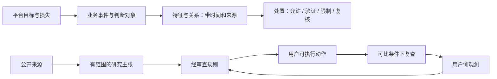

# 知彼的风控研究框架

**平台为什么判断、判断哪个对象、掌握什么证据、采取什么行动？**
这是知彼组织 目标服务 风控研究的四个问题。框架服务于用户注册准备与异常诊断，
也用于约束我们自己的产品：不能把采样结果直接翻译成“会不会封号”。

这是项目提出的研究框架 v0.1，不是已经还原的 目标服务 内部模型。新颖性、预测效果和注册成效均未验证。

## 一张图看懂



上层描述研究问题，下层是目前实现的产品链路。平台侧特征和处置多半不可见，
箭头表示待研究的联系，不表示已知因果关系。

## 阅读顺序

先看 [六层问题与三种交付对照](../../reference/risk-layers.md)，明确本地能测什么、Agent 怎样自检、教程如何指导。

1. [决策模型](decision-model.md)：从平台 motivation 到业务事件和不同损失。
2. [特征、Graph 与时间](features-and-graph.md)：哪些可测，哪些必须保持未知。
3. [研究假设与实验](hypotheses.md)：如何反驳主张、处理混杂和评价产品。
4. [主张与特征目录](catalog.md)：由代码中的知识库生成，和 CLI 使用同一份数据。

```bash
zhibi theory                         # 读主张、证据边界与修订条件
zhibi theory --format json           # 获取有类型的节点和边
zhibi explain network.route          # 看一条产品判断如何受研究约束
zhibi learn graph                    # 阅读一个短章节
zhibi lab routing                   # 动手检验正常反例
```

## 哪些是已知，哪些只是推测

| 层次 | 例子 | 知彼如何使用 |
| --- | --- | --- |
| 官方政策 | 明示的服务条件、申诉入口 | 保留适用范围、核对日、生效日，指导人工确认 |
| 官方机制披露 | 反蒸馏中的行为与基础设施关联 | 只支持已披露场景，不迁移成普通注册规则 |
| 跨平台类比 | 支付交易评分、机器人识别、账号关系 | 帮助提出研究问题，不能启用 目标服务 确定性判断 |
| 本地可复现语义 | 同一端点、地址族和时间内的两次出口 | 支持配置解释，不证明平台使用该特征 |
| 平台/产品假设 | 分阶段处置，解释未知能减少无效操作 | 注册研究设计，等待数据；默认 proposed |

主张状态是 `proposed / supported / contradicted / retired`，支持状态必须连同 scope 阅读。
一条“测量语义得到支持”的主张，仍不证明它是封号因素。

## 进入产品的门槛

目前的判断需要可见输入、明确范围、正常反例、证据有效期和复查方式。代码阻止
待验证、被反驳、撤回和跨平台类比主张直接产生确定结论。来源失效时降低判断确定性。
这些检查保护推导链；它们不能自动评审论文质量或保证人工录入的知识正确。

本框架由 [研究方法](../../reference/research-method.md) 和 [贡献流程](../../../CONTRIBUTING.md) 维护。
