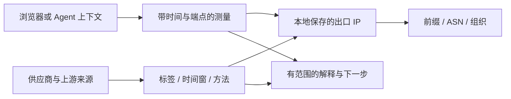

# 知彼的六层风控分析与三种交付

更新：2026-10-19。本文定义产品框架与目标能力；实现状态单独标注。

用户要解决的是“注册前该准备什么、遇到问题该怎么定位”。知彼将分析对象分成六层，
从服务条件、网络路径到账号行为与关系。层号不是风险等级，也不表示 上游服务商 实际按这个顺序决策。
注册、登录、付款、使用是贯穿各层的业务阶段；Web、目标客户端、API 则是不同产品入口。

## 每层的风险、特征与交付

| 层 | 要研究的风险或问题 | 能观测或验证的特征 | 本地检测如何帮助 | Skill 如何帮助 | Tutorial 如何帮助 |
| --- | --- | --- | --- | --- | --- |
| L0 服务资格与政策 | 服务地区、使用条件、产品范围不符 | 当前官方条件、版本与日期；用户自述的真实使用背景 | 显示官方核对清单；IP 归属不代替真实所在地或资格判断 | 先识别产品和阶段，指出需要用户核对的条件 | 解释注册前置条件、政策变化和官方求助入口 |
| L1 网络路径与连接 | 代理未生效、有意或意外分流、IPv6 路径差异、解析或连接失败 | 浏览器与 Agent 的 IPv4/IPv6 出口、端点、时间；代理配置摘要；DNS 实际解析路径、WebRTC 候选；连接错误类别 | 测量实际请求走哪条路径；区分测量失败和路径差异；已接入 WebRTC 和独立 dig 观察；浏览器 DNS 仍需单独证据 | 自查自己运行的本机、SSH 或容器环境，核对是否与用户浏览器可比；引导复查 | 解释系统代理、浏览器代理和进程代理的差别，以及正常分流 |
| L2 IP 身份、信誉与欺诈情报 | 共享出口的历史滥用、代理网络标签、陈旧或冲突的 IP 情报 | ASN/前缀/组织/网络类型；VPN、Tor、中继、住宅代理等来源标签；观察时间与方法；举报类别/数量/窗口；供应商原始评分及参数 | 汇总授权情报，显示来源、时效、分歧和未覆盖项；不输出自造的封号概率 | 按已启用数据源查询，解释命中原因、来源重叠和正常反例；记录复查结果 | 教用户读懂分数与标签，辨认“未发现记录”和“已证明安全”的差别 |
| L3 浏览器与客户端 | 登录所需能力受限、客户端故障、自动化环境与人工浏览器混淆 | 当前页面 JS/Cookie 支持/存储能力、客户端版本、自动化标记；真实站点行为由用户确认 | 测基础能力；语言和时区作为背景；测试页结果保留站点范围限制 | 区分 Agent 测试浏览器与用户日常浏览器，定位具体能力问题 | 说明哪些设置影响功能；不将时区、语言或单个指纹值包装成封号原因 |
| L4 账号、验证与支付 | 身份验证失败、账号安全问题、支付拒绝或官方账号限制 | 用户主动提供的脱敏提示类别、发生阶段与时间；官方工单状态 | 生成需人工核对的项目；不读取会话、密码、卡号或验证码 | 按提示分类，区分登录问题、付款问题和账号限制，整理求助材料 | 指导在官方页面完成验证、付款核查或申诉，说明材料如何脱敏 |
| L5 行为、时间与关系 Graph | 重试失控、资源滥用、协同行为，以及将正常共享关系误判为关联 | 用户选定的本地快照、时间、入口、出口变化；主动提供的脱敏错误/重试摘要；公开机制资料 | 展示可比快照的变化及观测关系；不声称发现平台内部账号关联 | 识别缺失证据、重复失败和变化顺序，建议按明确原因处理；不试探平台阈值 | 解释时间窗口、混杂因素、正常反例；复盘成功与失败案例 |

L1 的故障可能完全不属于欺诈问题；L2 的命中不自动意味着 L4 的账号限制。
例如一个连接超时不能推导为封号，一次支付失败也不能只用 IP 分数解释。

## 三种交付共享同一套解释

- **本地检测**给人看的结果：事实、来源、可能解释、具体下一步。
- **Skill**分为检测与协助模式：检测取得证据，协助按用户流程推进并按需调用检测，读取最小摘要并辅助复查。
- **Tutorial**解释测量原理、注册准备流程、报告含义和案例复盘方法。

它们使用同一套特征定义、来源和规则。Skill 不另写一套“凭经验打分”；教程中的步骤要能对应工具结果。
第一版重点实现 L1–L3；L0、L4 主要提供核对与分流；L5 先做本地可见的时间与证据关系。

## Graph 到底记录什么

第一版要连接三类关系：

1. **观测关系**：哪个运行上下文，在什么时间，向哪个端点发出请求，得到什么出口。
2. **网络关系**：IP 属于哪个前缀、ASN、组织，以及供应商如何描述这种关系。
3. **证据关系**：谁给出的标签、观察时间、查询参数、上游数据源，以及哪条建议引用了它。

关系都是有来源的陈述。两个来源使用同一上游数据库，不计为两次独立验证；
两个用户共享 IP，也不能据此判为同一人或恶意团伙。

当前代码已有 source → claim → rule 的证据图，以及用户指定快照的本地事件图。
增强报告已实现供应商及已声明上游依赖 → 带时间的观测 → 解释 → 行动的证据图，ASN 分歧参与解释。
完整 IP/前缀/ASN 实体网络图尚未实现。平台掌握的全局账号、支付与行为图仍然不可见。

## Agent 的“自我检测”具体指什么

Skill 的目标流程为：识别运行上下文 → 列出实际可用检查 → 执行本地检查 →
按既有授权查询外部情报 → 解释结果 → 用户处理后复测。

同一台电脑上的浏览器和终端也可能有不同路径。远程 Agent 测出的出口，只能说明远程进程到该端点的请求。
Skill 必须标注观测主体；需要用户实际浏览器结果时导入其本地导出，不能把自己的测试当成用户环境。
第三方 API Key 由本地核心读取，模型只获得筛选后的摘要。

当前 Skill 已封装能力检查、环境检查、浏览器导入、报告解释和复查命令；
入口已区分检测与协助两种模式，协助流程由用户提供，作者的详细注册步骤仍待补充。
七个情报适配器与打包后的行为测试已接入；宿主自动发现和跨系统实机验证需分别记录。
自动修复、后台持续监控均不属于已交付能力。

## 判断一个层级是否“解决了问题”

每条结论记录：`对象 / 产品 / 阶段 / 时间 / 观测 / 来源 / 替代解释 / 下一步 / 复查条件`。
结论按“发现具体问题、需要人工确认、可选检查未完成、当前未观察到异常”表达，
并保留底层测量状态。未知和失败不记成安全；复查成功只证明所查问题得到处理。

官方服务资格和申诉分别参考 [可用地区](https://support.claude.com/en/articles/8461763-where-can-i-access-claude)
与 [Safeguards warnings and appeals](https://support.claude.com/en/articles/8241253-safeguards-warnings-and-appeals)。
上游服务商 的 [反蒸馏防护披露](https://www.anthropic.com/research/distillation-defenses)
可支持特定滥用场景下的研究，不能迁移成普通注册阈值。

[IP 检测原理与交付标准](ip-intelligence.md) · [理论模型](theory/decision-model.md) · [当前能力](validation.md)
